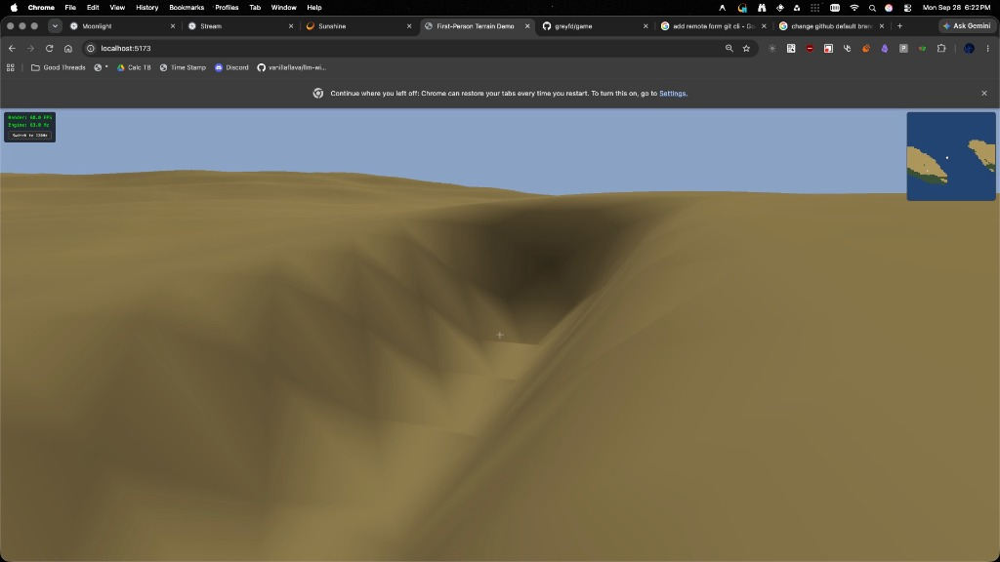

### 📝 Description
Currently, river generation begins at arbitrary points on the terrain, resulting in rivers that seemingly start out of nowhere. We need to update the terrain generation logic so rivers have a physically feasible source, such as flowing out of a cave carved into the terrain or originating from a specific terrain feature (like a spring, lake, or mountain runoff).

### 🔄 Steps to Reproduce
1. Load the First-Person Terrain Demo.
2. Explore the generated terrain until a river is found.
3. Trace the river back to its source.
4. Notice that it abruptly starts on open terrain without a logical origin.

### 🎯 Expected Behavior
Rivers should have a realistic starting point. For example, they should spawn from inside a terrain formation (acting as a cave source) or originate from a specific visual feature that makes their existence logical within the environment.

### 💥 Actual Behavior
Rivers spawn randomly on the map surface with no apparent source.

### 🚨 Severity & Impact
**P2 / Medium**
- *Reasoning:* This is an environmental logic and immersion issue. It doesn't break the game or block features, but it visibly impacts the quality and realism of the procedural generation.

### 💻 Environment
- **OS:** macOS 
- **Version/Commit:** Current main branch
- **Context:** WebGPU First-Person Terrain Demo

### 💡 Proposed Solution
There are two potential approaches to explore (likely a mix of both depending on the environment):

1. **Cave Origin (Net-New System):** Modify the terrain generation to carve an overhang or cave at the start node of the river path. *Note: We do not currently have cave generation, so this would require building a new terrain carving mechanic.*
2. **Feature Origin (Asset Mix):** Alternatively, place a specific prop or terrain feature at the starting coordinate of the river. This could be a mix of different source objects depending on the biome/altitude (e.g., a simple spring asset, a small lake, or melting snowcaps).
