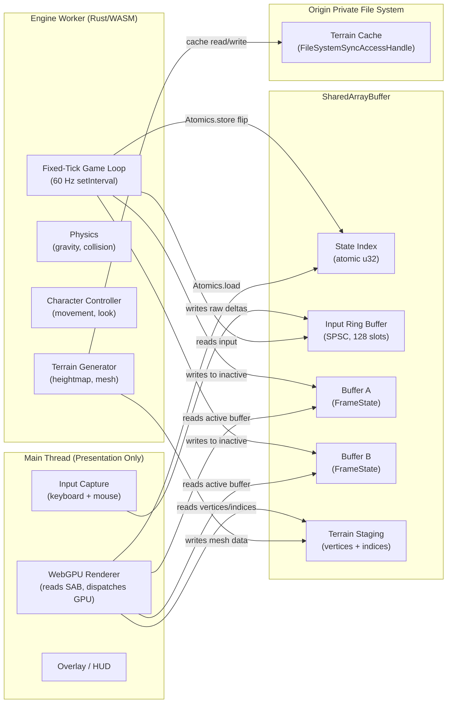
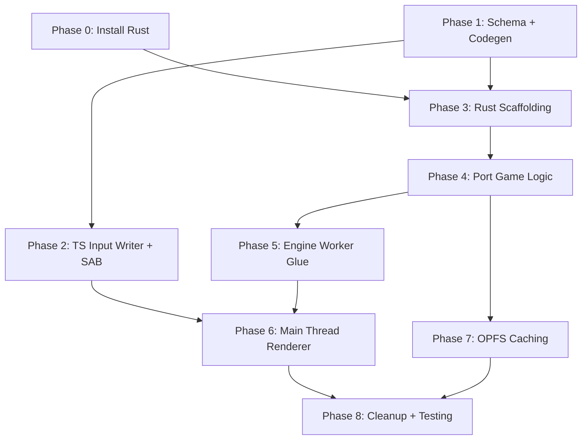

# Migration Plan: Single-Thread Demo to Production Architecture

## Table of Contents
1. [Architecture Overview](#1-architecture-overview)
2. [Prerequisites](#2-prerequisites)
3. [SharedArrayBuffer Memory Map](#3-sharedarraybuffer-memory-map)
4. [Schema Design](#4-schema-design)
5. [Phase Breakdown](#5-phase-breakdown)
6. [File Manifest](#6-file-manifest)
7. [What Gets Deleted](#7-what-gets-deleted)
8. [Risk Assessment](#8-risk-assessment)
9. [Open Design Questions](#9-open-design-questions)

---

## 1. Architecture Overview



### The Loop (per frame)

**Engine Worker (fixed 60 Hz):**
1. Read all pending `InputFrame` slots from the ring buffer
2. Accumulate input into player state (yaw, pitch, movement vector)
3. Run physics tick (gravity, collision against heightmap)
4. Compute view-projection matrix from updated camera
5. Write `FrameState` to the **inactive** buffer (A or B)
6. `Atomics.store` to flip the state index

**Main Thread (vsync via requestAnimationFrame):**
1. Capture raw input events, write `InputFrame` to ring buffer
2. `Atomics.load` the state index to find the active buffer
3. `device.queue.writeBuffer` the viewProjection matrix from active buffer
4. Check terrain ready flag; if set, upload mesh to GPU, clear flag
5. Dispatch WebGPU render pass

> [!IMPORTANT]
> The main thread never computes physics or matrices. It is a dumb pipe from SAB to GPU.

---

## 2. Prerequisites

Rust is **not installed** on this machine. Before any Rust code can compile:

```bash
# 1. Install Rust via rustup
curl --proto '=https' --tlsv1.2 -sSf https://sh.rustup.rs | sh

# 2. Add the wasm32 target
rustup target add wasm32-unknown-unknown

# 3. Install wasm-pack (builds wasm-bindgen + .wasm output)
cargo install wasm-pack

# 4. Verify
wasm-pack --version
```

> [!WARNING]
> All of Phase 3 and beyond is blocked on this. Phase 1 (codegen) and Phase 2 (SAB layout + TS input writer) can proceed without Rust.

---

## 3. SharedArrayBuffer Memory Map

Every byte offset is deterministic and generated by `codegen.js` from `schema.json`.

```
Offset (bytes)   Size        Region                      Access Pattern
───────────────────────────────────────────────────────────────────────────
0                4           state_index (atomic u32)     Worker: Atomics.store
                                                         Main:   Atomics.load

4                4           input_write_head (atomic u32) Main:   Atomics.store
                                                          Worker: Atomics.load

8                4           input_read_head (atomic u32)  Worker: Atomics.store
                                                          Main:   (read-only for debug)

12               4           terrain_ready (atomic u32)    Worker: Atomics.store(1)
                                                          Main:   Atomics.load, then store(0)

16               2048        input_ring_buffer             Main: write
                             128 slots x 16 bytes          Worker: read
                             (InputFrame struct)

2064             16-align    --- alignment padding ---

2080             208         buffer_a (FrameState)         Worker: write (when inactive)
                                                          Main:   read  (when active)

2288             208         buffer_b (FrameState)         Worker: write (when inactive)
                                                          Main:   read  (when active)

2496             4           terrain_vertex_count (u32)    Worker: write
                                                          Main:   read

2500             4           terrain_index_count (u32)     Worker: write
                                                          Main:   read

2504             8           --- alignment padding ---

2512             ~2.36 MB    terrain_vertices              Worker: write
                             128*128 verts x 24 bytes/vert Main:   read (on ready flag)

~2,415,120       ~588 KB     terrain_indices               Worker: write
                             127*127*6 indices x 4 bytes   Main:   read (on ready flag)

~3,003,120                   TOTAL SAB SIZE (~2.86 MB)
                             (rounded up to 16-byte alignment)
```

> [!NOTE]
> Exact offsets will be computed by `codegen.js` from the struct definitions and region declarations in `schema.json`. The values above are illustrative based on a 128x128 grid.

### Why double-buffer only FrameState, not terrain?

Terrain mesh data changes **infrequently** (only when new chunks load). Double-buffering it would waste ~5 MB of SAB. Instead, terrain uses a **ready flag** protocol:
1. Worker writes full mesh, then `Atomics.store(terrain_ready, 1)`
2. Main thread detects `terrain_ready === 1`, uploads to GPU, then `Atomics.store(terrain_ready, 0)`
3. Worker waits for `terrain_ready === 0` before writing again

---

## 4. Schema Design

The expanded `schema.json` drives all code generation:

```json
{
  "structs": [
    {
      "name": "InputFrame",
      "fields": [
        { "name": "keys_bitmap", "type": "u32" },
        { "name": "mouse_dx",    "type": "f32" },
        { "name": "mouse_dy",    "type": "f32" },
        { "name": "dt",          "type": "f32" }
      ]
    },
    {
      "name": "FrameState",
      "fields": [
        { "name": "view_projection", "type": "mat4x4<f32>" },
        { "name": "camera_position", "type": "vec3<f32>" },
        { "name": "player_position", "type": "vec3<f32>" },
        { "name": "player_velocity", "type": "vec3<f32>" },
        { "name": "player_yaw",      "type": "f32" },
        { "name": "player_pitch",    "type": "f32" },
        { "name": "player_on_ground","type": "u32" },
        { "name": "tick_count",      "type": "u32" }
      ]
    }
  ],
  "memory_regions": {
    "input_ring_buffer_capacity": 128,
    "terrain_grid_size": 128,
    "terrain_cell_size": 2.0,
    "terrain_floats_per_vertex": 6,
    "terrain_bytes_per_index": 4
  }
}
```

### Codegen outputs:

| Target | File | Content |
|--------|------|---------|
| Rust | `rust-engine/src/generated.rs` | `#[repr(C)]` structs with explicit padding fields |
| WGSL | `src/shaders/generated.wgsl` | Structs with `@align` / `@size` annotations |
| TypeScript | `src/shared/generated.ts` | Byte offset constants + struct sizes + SAB region offsets |

### Key bitfield: `keys_bitmap`

```
Bit 0: W (forward)
Bit 1: S (backward)
Bit 2: A (left)
Bit 3: D (right)
Bit 4: Space (jump)
Bits 5-31: reserved
```

This packs all key states into a single `u32`, avoiding multiple boolean fields and their alignment waste.

---

## 5. Phase Breakdown

### Phase 0: Toolchain Setup
> **Blocked on:** User action (install Rust)
> **Estimated effort:** 5 minutes

| # | Task | Detail |
|---|------|--------|
| 0.1 | Install Rust | `curl --proto '=https' --tlsv1.2 -sSf https://sh.rustup.rs \| sh` |
| 0.2 | Add wasm32 target | `rustup target add wasm32-unknown-unknown` |
| 0.3 | Install wasm-pack | `cargo install wasm-pack` |
| 0.4 | Verify | `wasm-pack --version` succeeds |

---

### Phase 1: Schema + Codegen Overhaul
> **Depends on:** Nothing (pure Node.js)
> **Estimated effort:** ~200 lines

| # | Task | Detail |
|---|------|--------|
| 1.1 | Expand `schema.json` | Add `InputFrame`, `FrameState`, and `memory_regions` section |
| 1.2 | Upgrade `codegen.js` | Parse `memory_regions` to compute SAB layout. Generate a `MemoryMap` TS class with all region offsets and total SAB size. Generate Rust constants. Fix the `@size` trailing-field bug from the review. |
| 1.3 | Add `codegen` npm script | `"codegen": "node scripts/codegen.js"` in package.json |
| 1.4 | Run codegen, verify outputs | Check `generated.ts`, `generated.wgsl`, `generated.rs` for correct offsets |

**Key codegen enhancement:** The script must now also emit:
- `MemoryMapOffsets` class in TS with `STATE_INDEX`, `INPUT_WRITE_HEAD`, `INPUT_READ_HEAD`, `TERRAIN_READY`, `INPUT_RING_START`, `BUFFER_A_START`, `BUFFER_B_START`, `TERRAIN_VERTEX_COUNT`, `TERRAIN_INDEX_COUNT`, `TERRAIN_VERTICES_START`, `TERRAIN_INDICES_START`, `TOTAL_SAB_SIZE`
- Equivalent Rust `const` block

---

### Phase 2: TypeScript Input Writer + SAB Allocation
> **Depends on:** Phase 1
> **Estimated effort:** ~150 lines

| # | Task | Detail |
|---|------|--------|
| 2.1 | Create `src/shared/input-writer.ts` | SPSC ring buffer producer. Takes the SAB and writes `InputFrame` structs at `input_write_head`. Uses `Atomics.store` on write head after memcpy. |
| 2.2 | Refactor `src/input.ts` | Keep keyboard/mouse capture. Each frame, pack state into an `InputFrame` and call `InputWriter.push()`. Remove direct player interaction. |
| 2.3 | Update `src/main.ts` | Allocate SAB using `MemoryMapOffsets.TOTAL_SAB_SIZE`. Create input writer. Remove `Player`, `Heightmap`, `Camera` imports. The main thread becomes a pure renderer that reads the active `FrameState` buffer. |
| 2.4 | Create `src/shared/sab-reader.ts` | Helper to read `FrameState` from the active buffer. `Atomics.load` the state index, compute the offset, return a typed view. |

---

### Phase 3: Rust Engine Scaffolding
> **Depends on:** Phase 0 (Rust installed), Phase 1 (codegen)
> **Estimated effort:** ~300 lines

| # | Task | Detail |
|---|------|--------|
| 3.1 | Create `rust-engine/Cargo.toml` | Dependencies: `wasm-bindgen`, `js-sys`, `web-sys` (features: Worker, SharedArrayBuffer, console), `glam` (for vec3/mat4 math). Target: `cdylib`. |
| 3.2 | Create `rust-engine/src/lib.rs` | FFI entry points: `init(sab: JsValue)` receives SAB and casts to raw pointer. `tick()` runs one simulation step. Both exported via `#[wasm_bindgen]`. |
| 3.3 | Create `rust-engine/src/memory.rs` | Unsafe module that casts the SAB raw pointer to typed slices. Provides safe accessors: `read_input_frame(slot)`, `write_frame_state(buffer_index, state)`, `read_state_index()`, `flip_state_index()`. All atomic operations use `std::sync::atomic`. |
| 3.4 | Verify build | `wasm-pack build --target web --out-dir ../pkg` produces `rust_engine_bg.wasm` + JS glue. |

**Critical design in `memory.rs`:**

```rust
// The SAB pointer is stored as a global static.
// This is safe because the worker is single-threaded
// and only one WASM instance accesses this side.
static mut SAB_PTR: *mut u8 = std::ptr::null_mut();
static mut SAB_LEN: usize = 0;

#[wasm_bindgen]
pub fn init(sab: JsValue) {
    // Cast JsValue -> SharedArrayBuffer -> backing store pointer
    // Store in SAB_PTR
}
```

The `Atomics` operations on the control words (state_index, heads, terrain_ready) must use `core::sync::atomic::AtomicU32` with appropriate orderings:
- **State index flip:** `Release` store (ensures all data writes are visible before flip)
- **State index read (main thread):** `Acquire` load (ensures subsequent data reads see the written values)
- **Input write head:** `Release` store from main, `Acquire` load from worker
- **Input read head:** `Release` store from worker

> [!IMPORTANT]
> This is the fix for the "non-atomic writes on ARM" bug from the code review. The `Release/Acquire` pair creates the memory fence that was missing in the old `engine.worker.ts`.

---

### Phase 4: Port Game Logic to Rust
> **Depends on:** Phase 3
> **Estimated effort:** ~400 lines

| # | Task | Detail |
|---|------|--------|
| 4.1 | Create `rust-engine/src/input.rs` | SPSC ring buffer consumer. Reads `InputFrame` slots between `read_head` and `write_head`. Decodes `keys_bitmap` into bool flags. Accumulates mouse deltas across multiple frames (worker may run slower than main thread). |
| 4.2 | Create `rust-engine/src/player.rs` | Port `src/player.ts` logic: WASD movement (diagonal normalization), mouse look (yaw/pitch with clamping), gravity, jump, velocity integration. Uses `glam::Vec3` and `glam::Mat4`. |
| 4.3 | Create `rust-engine/src/terrain.rs` | Port `src/terrain/heightmap.ts`: layered sine-wave generation, bilinear height sampling, normal computation. Port `src/terrain/mesh.ts`: grid vertex/index generation. Write output directly to SAB terrain region. |
| 4.4 | Create `rust-engine/src/camera.rs` | Port `src/math/mat4.ts` `mat4FpsView` and `mat4Perspective`. Use `glam::Mat4::perspective_rh` (with manual Z [0,1] adjustment for WebGPU) and build the view matrix from yaw/pitch. |
| 4.5 | Wire `tick()` in `lib.rs` | Read input -> update player -> compute camera matrices -> write FrameState to inactive buffer -> flip state index. |

**Porting strategy for terrain:**

The Rust terrain generator writes directly into the SAB at the terrain region offset:
```rust
pub fn generate_terrain(sab: &mut [u8]) {
    let header_offset = TERRAIN_VERTEX_COUNT_OFFSET;
    let vert_offset = TERRAIN_VERTICES_START;
    let idx_offset = TERRAIN_INDICES_START;

    // Generate heightmap
    // Write interleaved (pos + normal) floats starting at vert_offset
    // Write u32 indices starting at idx_offset
    // Write counts to header
    // Atomics.store(terrain_ready, 1)
}
```

---

### Phase 5: Engine Worker (TypeScript glue)
> **Depends on:** Phase 4
> **Estimated effort:** ~80 lines

| # | Task | Detail |
|---|------|--------|
| 5.1 | Rewrite `src/workers/engine.worker.ts` | Load WASM module via `wasm-pack` generated glue. On `INIT` message: receive SAB, call `wasm.init(sab)`, call `wasm.generate_terrain()`, start `setInterval(() => wasm.tick(), 1000/60)`. |
| 5.2 | Update Vite config | Ensure `.wasm` files are served correctly. May need `optimizeDeps.exclude` for the wasm package. |

---

### Phase 6: Main Thread as Pure Renderer
> **Depends on:** Phase 2, Phase 5
> **Estimated effort:** ~200 lines

| # | Task | Detail |
|---|------|--------|
| 6.1 | Rewrite `src/main.ts` | Allocate SAB. Send to worker. Start `requestAnimationFrame` loop that: (a) packs input into ring buffer, (b) reads active FrameState, (c) checks terrain_ready flag, (d) renders. |
| 6.2 | Update `src/render/terrain-pipeline.ts` | Add a `updateMesh()` method that re-creates vertex/index GPU buffers from SAB terrain data (called when terrain_ready fires). |
| 6.3 | Handle projection matrix | The projection matrix depends on canvas aspect ratio, which the worker does not know. Two options: (A) send aspect ratio via a dedicated SAB field, (B) compute projection on main thread and multiply with view matrix from SAB. **Option B is simpler** -- the worker writes the view matrix, the main thread computes and multiplies projection. |

> [!TIP]
> Option B means `FrameState` contains `view_matrix` (not `view_projection`), and the main thread does one `mat4Multiply(vp, projection, view)` per frame. This is a single 64-float multiply -- negligible cost, and it lets the main thread respond to resize immediately without SAB round-trips.

---

### Phase 7: OPFS Terrain Caching
> **Depends on:** Phase 4 (terrain generation works)
> **Estimated effort:** ~150 lines

| # | Task | Detail |
|---|------|--------|
| 7.1 | Create `rust-engine/src/opfs.rs` | Bindings to `FileSystemSyncAccessHandle` via `web-sys`. Functions: `cache_exists(name)`, `write_cache(name, data)`, `read_cache(name, dest)`. |
| 7.2 | Add caching logic to `terrain.rs` | On startup: check OPFS for cached heightmap. If found, read directly into SAB. If not, generate and write to both SAB and OPFS. |
| 7.3 | Worker-side OPFS initialization | In `engine.worker.ts`, obtain the OPFS root via `navigator.storage.getDirectory()` and pass the directory handle to the WASM init function. |

> [!NOTE]
> `FileSystemSyncAccessHandle` is **only available in Web Workers**, which is exactly where the Rust engine runs. The main thread cannot use it, which is why all file I/O lives in the worker.

---

### Phase 8: Cleanup + Integration Testing
> **Depends on:** All previous phases
> **Estimated effort:** ~100 lines

| # | Task | Detail |
|---|------|--------|
| 8.1 | Delete dead TS game logic | Remove `src/player.ts`, `src/camera.ts`, `src/math/vec3.ts`, `src/math/mat4.ts`, `src/terrain/heightmap.ts`, `src/terrain/mesh.ts`. These are now Rust. |
| 8.2 | Delete orphaned files | `src/physics.worker.ts`, `src/render/pipeline.ts`, `src/render/renderer.ts`, `src/render/shaders/common.wgsl`, `src/render/shaders/post.wgsl`, `src/workers/ai.worker.ts`, `src/audio/hrtf.worklet.ts`, `src/shared/memory_map.ts`. |
| 8.3 | Update `package.json` scripts | Add `"build:wasm": "cd rust-engine && wasm-pack build --target web --out-dir ../pkg"`, `"codegen": "node scripts/codegen.js"`, `"dev": "npm run codegen && npm run build:wasm && vite"`. |
| 8.4 | Verify ARM correctness | Test in Chrome on an Android device or Apple Silicon simulator to confirm the Release/Acquire fences prevent tearing. |
| 8.5 | Profile frame budget | Measure main thread frame time. Target: <2ms (pure GPU dispatch + SAB reads). All physics must live in the worker. |

---

## 6. File Manifest

### New files to create

| File | Phase | Language | Purpose |
|------|-------|----------|---------|
| `rust-engine/Cargo.toml` | 3 | TOML | Rust workspace, dependencies |
| `rust-engine/src/lib.rs` | 3 | Rust | WASM entry points (init, tick, generate_terrain) |
| `rust-engine/src/memory.rs` | 3 | Rust | SAB pointer access, atomic operations |
| `rust-engine/src/generated.rs` | 1 | Rust | (codegen) `#[repr(C)]` structs + memory map constants |
| `rust-engine/src/input.rs` | 4 | Rust | SPSC ring buffer consumer |
| `rust-engine/src/player.rs` | 4 | Rust | Character controller |
| `rust-engine/src/camera.rs` | 4 | Rust | View matrix from yaw/pitch, perspective projection |
| `rust-engine/src/terrain.rs` | 4 | Rust | Heightmap generation, mesh generation, height sampling |
| `rust-engine/src/opfs.rs` | 7 | Rust | OPFS FileSystemSyncAccessHandle bindings |
| `src/shared/input-writer.ts` | 2 | TS | SPSC ring buffer producer |
| `src/shared/sab-reader.ts` | 2 | TS | Read FrameState from active SAB buffer |

### Files to rewrite (in place)

| File | Phase | What changes |
|------|-------|-------------|
| `schema.json` | 1 | Add InputFrame, FrameState, memory_regions |
| `scripts/codegen.js` | 1 | Memory map generation, trailing padding fix |
| `src/shared/generated.ts` | 1 | (codegen output) MemoryMapOffsets + struct offsets |
| `src/shaders/generated.wgsl` | 1 | (codegen output) FrameState struct |
| `src/workers/engine.worker.ts` | 5 | Load WASM, start fixed-tick loop |
| `src/main.ts` | 6 | Pure renderer, SAB allocator, input writer |
| `src/render/terrain-pipeline.ts` | 6 | Add updateMesh() for SAB-sourced terrain data |
| `src/input.ts` | 2 | Remove player coupling, add ring buffer packing |
| `package.json` | 8 | Build scripts |
| `vite.config.ts` | 5 | WASM serving config |

### Files to delete

| File | Reason |
|------|--------|
| `src/player.ts` | Ported to Rust |
| `src/camera.ts` | Ported to Rust |
| `src/math/vec3.ts` | Replaced by `glam` crate |
| `src/math/mat4.ts` | Replaced by `glam` crate |
| `src/terrain/heightmap.ts` | Ported to Rust |
| `src/terrain/mesh.ts` | Ported to Rust |
| `src/physics.worker.ts` | Dead code (orphaned from old demo) |
| `src/render/pipeline.ts` | Empty stub, never used |
| `src/render/renderer.ts` | Empty stub, superseded by `gpu.ts` |
| `src/render/shaders/common.wgsl` | Empty stub |
| `src/render/shaders/post.wgsl` | Empty stub |
| `src/workers/ai.worker.ts` | Empty stub (future, not part of this migration) |
| `src/audio/hrtf.worklet.ts` | Empty stub (future, not part of this migration) |
| `src/shared/memory_map.ts` | Empty stub, replaced by `generated.ts` |

---

## 7. Dependency Graph



**Critical path:** P0 -> P1 -> P3 -> P4 -> P5 -> P6 -> P8

**Parallelizable work:**
- Phase 1 and Phase 0 are independent (codegen is pure JS)
- Phase 2 (TS side) can run in parallel with Phase 3+4 (Rust side)
- Phase 7 (OPFS) can be done after Phase 4 and before Phase 8

---

## 8. Risk Assessment

| Risk | Severity | Mitigation |
|------|----------|------------|
| **wasm-bindgen SharedArrayBuffer interop** -- casting a JS `SharedArrayBuffer` to a raw `*mut u8` pointer in Rust requires unsafe code and careful lifetime management | High | Use `js_sys::SharedArrayBuffer::new()` with `Uint8Array::new_with_byte_offset_and_length()` to get a view, then copy pointer. The WASM linear memory and the SAB are **separate** -- the Rust code reads/writes via the SAB pointer, not WASM linear memory. Extensive unit testing of memory offsets. |
| **Atomic ordering mismatch** -- using `Relaxed` instead of `Release/Acquire` causes tearing on ARM | High | Codify the ordering rules in `memory.rs` with doc comments. The state index flip uses `Release`; the reader uses `Acquire`. All data writes happen before the Release store. |
| **Terrain mesh size overflow** -- a 128x128 grid produces ~393K vertices and ~580K indices, which at 24+4 bytes each is ~2.9 MB. If grid size increases, SAB must grow. | Medium | The `codegen.js` computes SAB size from `memory_regions` config. Changing `terrain_grid_size` automatically adjusts. Add a runtime check that SAB size does not exceed `2 GB` (browser limit). |
| **WASM build time** -- initial `wasm-pack build` can take 30-60s; iterative builds 5-10s | Low | Use `wasm-pack build --dev` for debug builds. Production uses `--release`. |
| **`FileSystemSyncAccessHandle` browser support** -- stable in Chrome 102+, not in Firefox/Safari | Medium | OPFS caching is Phase 7 and purely additive. The engine works without it (just regenerates terrain each load). Feature-detect at runtime. |
| **glam crate WASM compatibility** -- `glam` uses SIMD by default which may not compile for wasm32 | Low | Disable default features and enable `scalar-math`: `glam = { version = "0.29", default-features = false, features = ["scalar-math"] }` |

---

## 9. Open Design Questions

Before I start writing code, I need decisions on these:

### Q1: View Matrix vs. View-Projection Matrix in SAB

**Option A:** Worker computes and writes `view_projection` (64 bytes). Main thread uses it directly.
- Pro: Zero math on main thread.
- Con: Resize requires SAB round-trip (worker must know aspect ratio).

**Option B:** Worker writes `view_matrix` only (64 bytes). Main thread computes projection locally and multiplies.
- Pro: Instant resize response, no aspect ratio sync.
- Con: One mat4 multiply per frame on main thread (~negligible).

**Recommendation:** Option B. The plan above assumes this.

### Q2: Should Phase 7 (OPFS) be in scope for the first pass?

OPFS caching is an optimization. The terrain generates in <50ms for a 128x128 grid. If you want to ship the core architecture faster, Phase 7 can be deferred.

### Q3: Do you want me to proceed with execution after you approve, or stage it as separate PRs?

I can either:
- **(A)** Execute all 8 phases end-to-end in one pass
- **(B)** Execute Phases 1-2 first (no Rust needed), pause for you to install Rust, then continue 3-8

**Recommendation:** Option B, since Rust is not installed.

---

## Estimated Totals

| Metric | Value |
|--------|-------|
| New Rust code | ~900 lines |
| Modified TypeScript | ~500 lines |
| Codegen script | ~250 lines |
| New TypeScript modules | ~200 lines |
| WGSL changes | ~10 lines (codegen output) |
| Files created | ~11 |
| Files rewritten | ~10 |
| Files deleted | ~14 |
| **Total new/modified code** | **~1,850 lines** |
